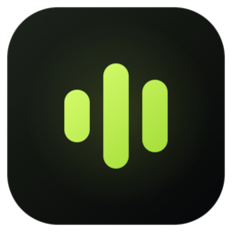
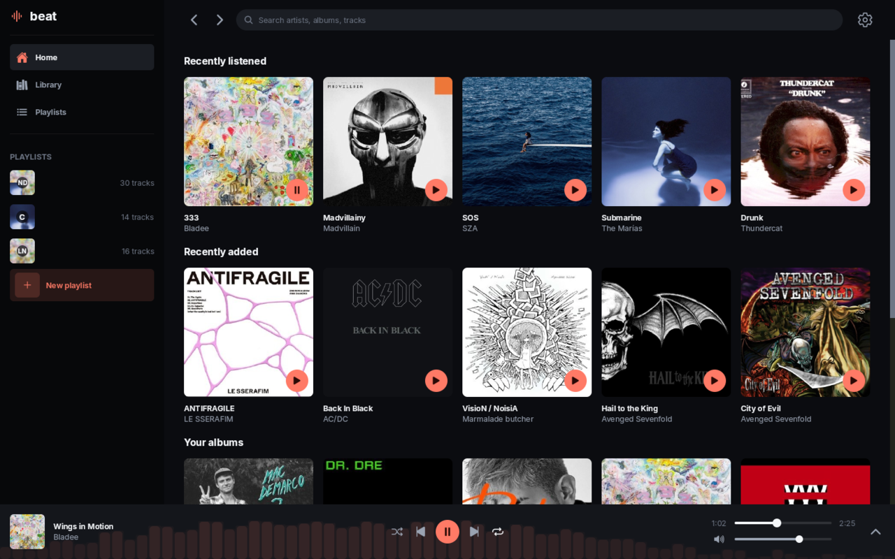
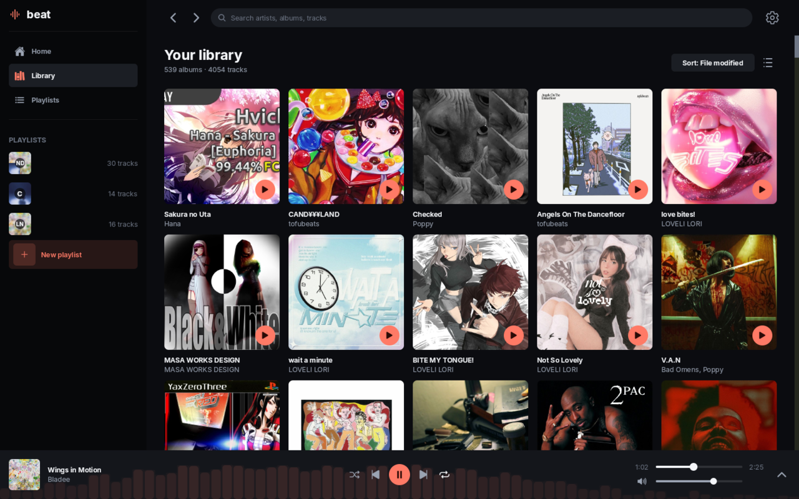
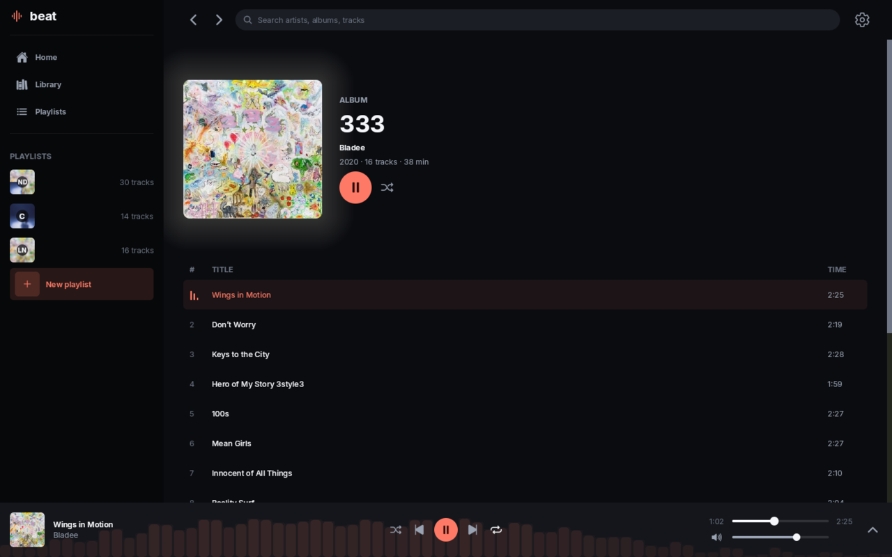
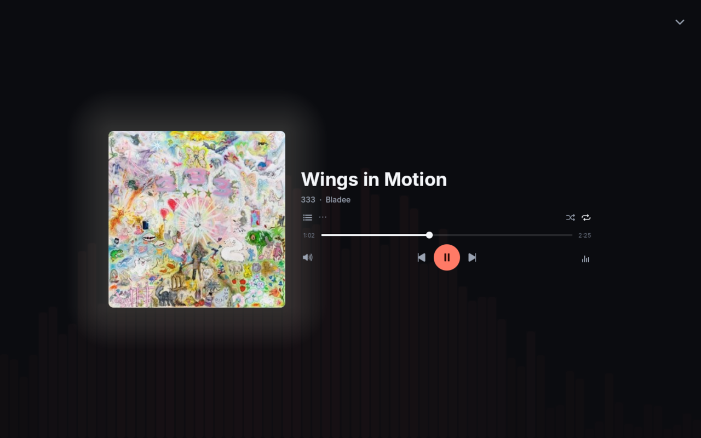
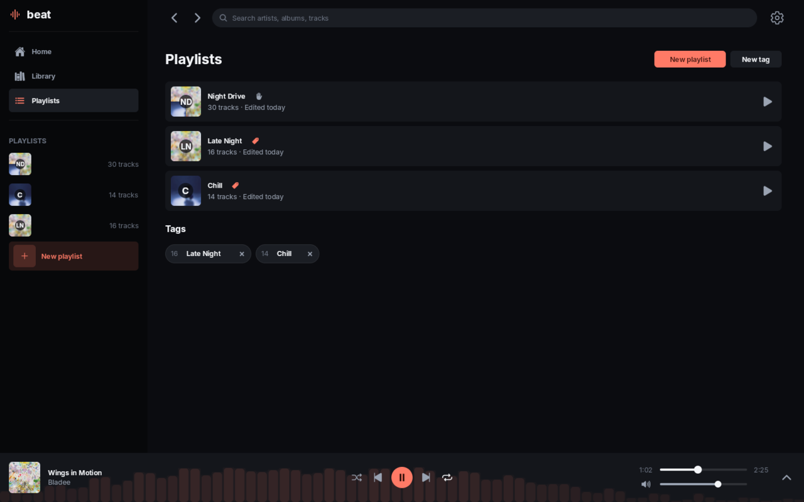
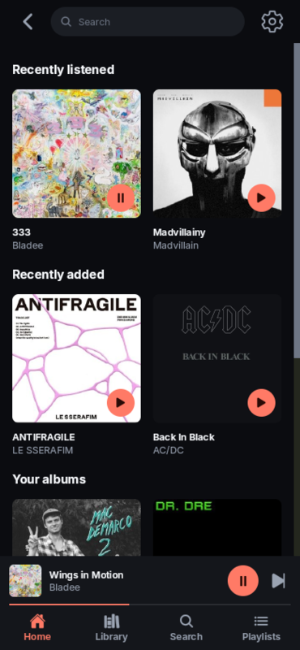

<p align="center">
  
</p>

<h1 align="center">beat</h1>

<p align="center">
  <strong>A tiny, fast, native music player for the files you already own.</strong>
</p>



## Highlights

- **Tiny: 4.1 MB.** One native executable. No runtime, no bundled browser, no installer.
- **Sips memory.** An empty window sits near 65 MB PSS; a 4,054-track library brings it to about 105 MB. The scanner peaks at roughly 60 MB while walking a 12 GB library.
- **Fast on slow libraries.** The window never walks your music folder. A coordinator scans it outside the app, then four inspector processes read files in parallel, so a high-latency mount keeps several reads in flight. Tracks, albums, search and covers appear as the scan runs.
- **LuaJIT all the way down.** Beat is written in Lua, JIT-compiled by LuaJIT, and built with [lde](https://lde.sh) into a self-contained native binary. No Lua installation, virtual machine or webview ships alongside it.
- **Last.fm, if you want it.** Connect an account in Settings for now-playing updates and scrobbles. Requests run off the UI thread, and failed scrobbles retry while beat is open.
- **Tags are playlists.** Tag tracks and each tag becomes a smart playlist; hand-picked playlists can be mixed with tag rules. Search filters use the same tags. Everything is stored as plain JSON beside your settings.

> **Plugins are in progress.** Most players put extensions behind a narrow SDK. Beat is a single LuaJIT process: the pages, services, library, tags and playback queue are all Lua, and the renderer and audio engine are lde packages exposed as Lua. Plugins will load into that same state, so they can call exactly what the app calls, extend any screen, and reach everything the app can reach. No IPC boundary, no ABI, no walled garden — if beat can do it, a plugin can do it. The loader and lifecycle are still being designed.

## Screenshots

<p align="center">
  <a href="docs/screenshots/library.png"></a>
  <a href="docs/screenshots/album.png"></a>
  <br>
  <a href="docs/screenshots/now-playing.png"></a>
  <a href="docs/screenshots/playlists.png"></a>
</p>

<p align="center">
  
  <br>
  <em>The same app at phone width.</em>
</p>

## Install

Download the archive for your platform from [Releases](https://github.com/bycruz/beat/releases). The rolling [`nightly`](https://github.com/bycruz/beat/releases/tag/nightly) prerelease has the newest build.

| Linux | Windows | macOS |
| :---: | :---: | :---: |
| x86-64 · arm64 | x86-64 · arm64 | Intel · Apple silicon |

Unzip it and run `beat` (`beat.exe` on Windows). The first launch asks for a music folder.

Beat needs a working Vulkan driver. Builds are not code-signed, so macOS may require right-click → Open on first launch and Windows may show SmartScreen.

**Controls:** `Space` play/pause · `←`/`→` seek · `/` search · `Ctrl+,` settings · `Ctrl+O` choose folder.

## Build

Install [lde](https://lde.sh/docs/general/setup/installation), a C toolchain and `glslang` (for the shaders), then:

```sh
lde sync -C packages/beat
lde run -C packages/beat      # run from source
lde compile -C packages/beat  # build one executable
lde test -C packages/beat     # headless tests
```

## Benchmarks

Measured on Linux x86-64 (Intel i7-9700F). The library lives on a Google Drive mount via rclone FUSE: **539 albums, 4,054 tracks, 12 GB**.

| Measurement | Result |
| --- | --- |
| Native executable | 4.06 MiB |
| App, empty window | ~130 MB RSS · ~65 MB PSS |
| App, full library loaded | ~166 MB RSS · ~105 MB PSS |
| Scan, 4 inspectors | 2.4–3.0 s · ~60 MB RSS total |
| Scan, 1 inspector | 17.5 s · ~39 MB RSS |

Scan times use a warm VFS cache. RSS includes shared libraries; PSS divides those pages across processes. Loading 4,054 tracks adds roughly 35 MB of memory over an empty window.

## Status

Beat is early software and nightlies are the only builds. Expect rough edges and changing behavior. Bug reports and ideas are welcome in [Issues](https://github.com/bycruz/beat/issues).
