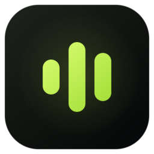
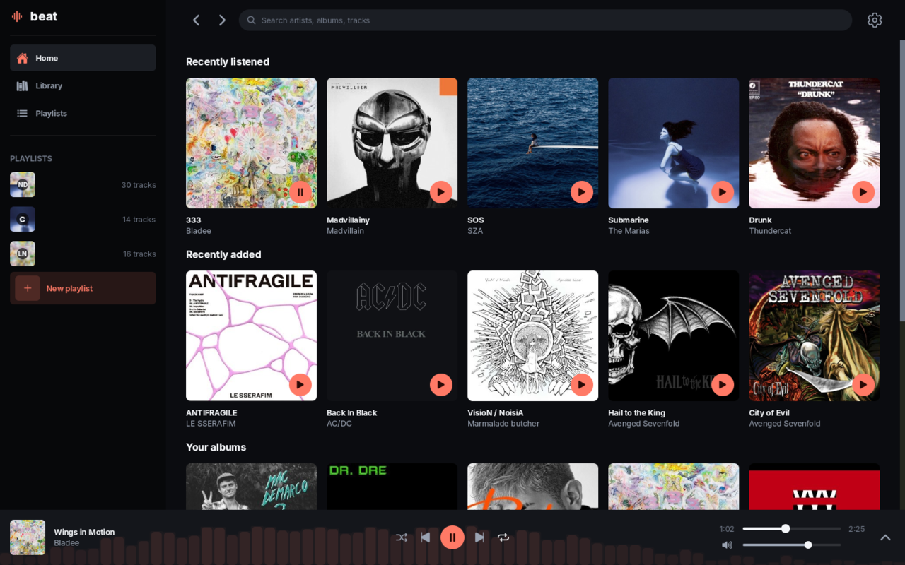
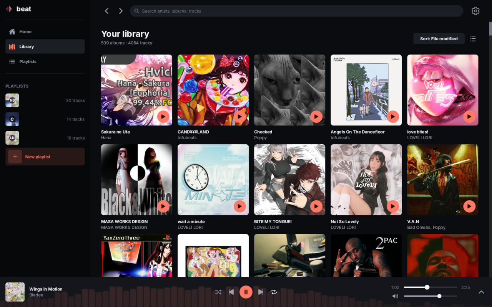
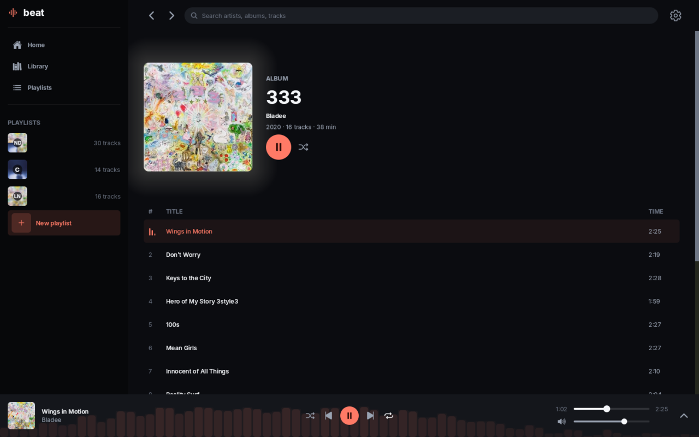
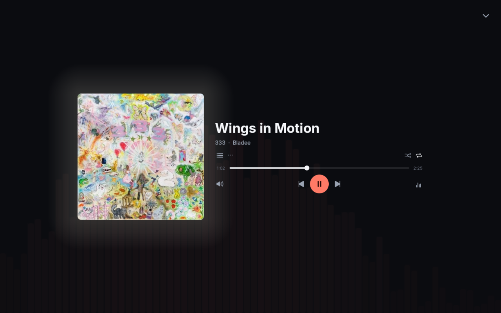
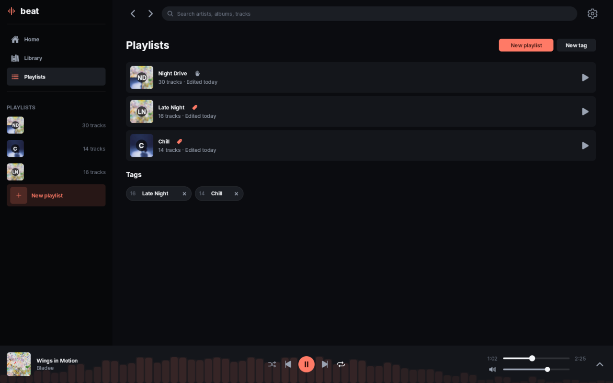
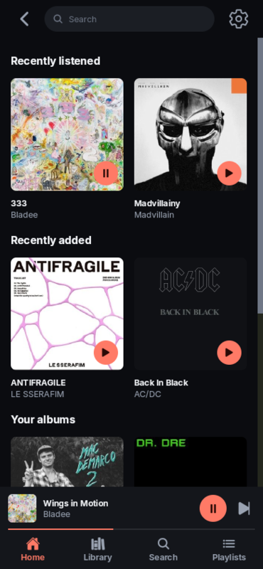

<p align="center">
  
</p>

<h1 align="center">beat</h1>

<p align="center">
  <strong>A small, fast and fully customizable music player.</strong>
</p>



## Features

- **Tiny.** One 4 MB executable. No runtime, no browser.
- **Fast scans.** Covers and tracks show up while the library is still scanning, even on network drives.
- **Tags and smart playlists.** Tag tracks, build playlists from tags, or mix in tracks by hand.
- **Five-band equalizer** and live spectrum.
- **Last.fm scrobbling.**
- **Plugins** in Lua. Settings → Plugins opens the folder to drop them in.
- **Self-updating.** Pick release or nightly builds in Settings.
- **Desktop and Android.**

## Screenshots

<p align="center">
  <a href="docs/screenshots/library.png"></a>
  <a href="docs/screenshots/album.png"></a>
  <br>
  <a href="docs/screenshots/now-playing.png"></a>
  <a href="docs/screenshots/playlists.png"></a>
</p>

<p align="center">
  
</p>

## Install

Grab your platform's file from [Releases](https://github.com/beat-player/beat/releases), or [nightly](https://github.com/beat-player/beat/releases/tag/nightly) for the newest build.

| Platform | Download                                       |
| -------- | ---------------------------------------------- |
| Windows  | `beat-windows-*.zip`                           |
| macOS    | `beat-macos-*.zip`                             |
| Linux    | `.AppImage`, `.flatpak`, or `beat-linux-*.zip` |
| Android  | `beat-android-*.apk`                           |

Requires a Vulkan driver. Builds are unsigned: on macOS right-click → Open the first time; on Windows, click past SmartScreen.

Flatpak: `flatpak install --user beat-linux-x86-64.flatpak`. It updates by installing a newer bundle.

**Shortcuts:** `Space` play/pause · `←` `→` seek · `/` search · `Ctrl+,` settings · `Ctrl+O` choose folder

## Build

Needs [lde](https://lde.sh/docs/general/setup/installation), a C compiler, and `glslang`.

```sh
lde run -C packages/beat      # run from source
lde compile -C packages/beat  # build the executable
lde test -C packages/beat     # run tests
```

## Performance

4,054 tracks (12 GB) on a Google Drive mount, Intel i7-9700F, Linux.

|                      |           |
| -------------------- | --------- |
| Executable           | 4.1 MB    |
| Memory, empty        | ~130 MB   |
| Memory, full library | ~166 MB   |
| Full scan            | 2.4–3.0 s |

## Status

Beat is early software. Only nightly builds are available. Behavior can change. Report bugs and ideas in [Issues](https://github.com/bycruz/beat/issues).
